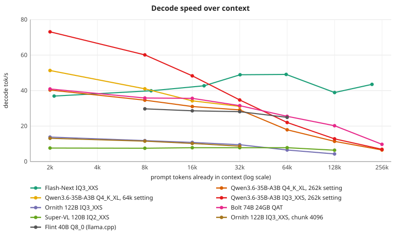
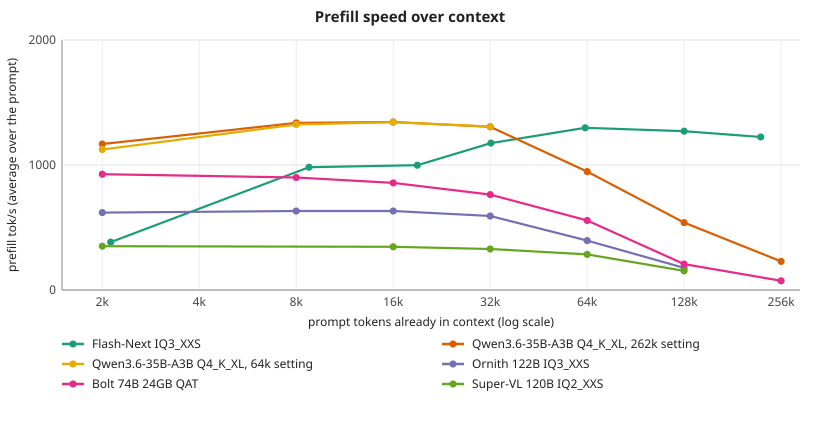

# Qwen3.6-35B-A3B

Measurements on the RTX 4060 Ti 16 GB test box (see [FORK.md](../../FORK.md) for the machine and the summary table). Warm decode in tok/s unless noted; the GPU power limit was 120 W for every number.

Upstream v0.2.10 runs the DFlash2 drafter only on Flash-Next. This branch runs the Qwen3.6-35B-A3B drafter
(`qwen3.6-35b-a3b-dflash2.q8.pack`) on the 35B itself (`strata --model <35B GGUF> --draft dflash2 --draft-model <pack> --spec 5`).

What changed:
- **Drafter shapes** (`src/core/dflash2.cpp`): the loader took only hidden size 2560. It now follows the pack, and two buffers that were
  sized for Flash-Next are fixed: the quantized-tap buffers held 5 taps (the 35B has 8, so the context kernels overflowed them) and the
  convolution coefficients were laid out 640 wide with the second half at +320 (that width is hidden/4: 512 for the 35B). Flash-Next's
  2560 gives the same values as before.
- **Engine hooks** (`src/qwen35/q36_engine.cu`): taps are copied out of the residual stream after the pack's 8 layers, in the prompt
  chunks, single steps and verify windows; the drafter reads the engine's own embedding and output matrix (no copy); a DFlash2 step
  drafts, verifies the window and commits like the MTP step. `STRATA_Q36_DF2_TAP_SHIFT` moves the tap layers (0 = after the layer the pack
  names); `STRATA_Q36_DF2_TRACE=1` prints drafts against picks.

Measured (RTX 4060 Ti VM, UD-Q4_K_XL, 200 tokens, temperature 0, one run each, no KV quantization, 8 CPU threads):

| Prompt | Plain decode | DFlash2 depth 5 | Drafts accepted |
|---|---|---|---|
| code (LRU cache) | 55.6 tok/s | 90.7 | 73% |
| prose (immune system) | 57.7 | 63.2 | 49% |
| JSON list | 51.7 | 56.9 | 45% |

Q8_0 file (`Qwen3.6-35B-A3B-Q8_0.gguf`, no MTP block, 35 GB so most experts sit in host memory), same prompts, depth 5:

| Prompt | Plain decode | DFlash2 | Drafts accepted |
|---|---|---|---|
| code | 32.4 tok/s | 38.9 (+20%) | 67% |
| prose | 32.9 | 37.4 (+14%) | 54% |
| JSON | 32.4 | 34.4 (+6%) | 49% |

Q8_0 depth sweep (`--spec N`, 200 tokens, temperature 0, one run per cell; plain decode 32.4 code / 32.9 prose):

| Depth | Code tok/s | Code accepted | Prose tok/s | Prose accepted |
|---|---|---|---|---|
| 2 | 41.5 | 82% | 41.0 | 81% |
| 3 | 44.9 | 82% | 34.5 | 66% |
| 4 | 47.1 | 73% | 38.1 | 59% |
| 5 | 38.9 | 67% | 37.4 | 54% |
| 6 | 44.3 | 63% | 39.2 | 48% |
| 7 | 37.1 | 59% | 29.8 | 44% |

Acceptance falls steadily with depth; throughput does not move smoothly (differences under about 5 tok/s are within the run-to-run
noise seen here, and depth 5 was not rerun). Depth 2-4 is the useful range: 4 for code, 2 for prose. Every prose run matched plain
decoding token for token; all code runs matched each other but differ from plain decoding.

The Q8_0 file needed one loader change: `nextn_predict_layers` is now optional in the architecture guard (a file without it has no MTP
block). DFlash2 is an external pack, so it does not depend on that block. The prose answer matched plain decoding token for token.

Code prompt at other settings: DFlash2 depth 3 reached 80.0 (84% accepted), depth 7 reached 88.4 (63%), and the model's own MTP at depth 2
reached 80.5 (83%). Before the buffer fixes the same pipeline accepted 2 of 625 drafts.

Caveats: DFlash2 output matches plain decoding for the first 111-137 tokens of each 200-token answer and then differs; the MTP at depth 2
matches exactly. The divergence is late, which fits near-tied tokens under different window kernels, but it is not proven to be that. The
Ornith drafter (hidden 3072, block size 16) loads but is not run: its block size needs 16 rows, the drafter uses 8. The path is
single-request (`--batch 1`); the serve loop is wired but untested, and there is no prompt-reuse handling (`begin_request`) yet.

## Performance over context (2026-11-06)

`strata-q36` from the `ornith-dflash2` worktree, `Qwen3.6-35B-A3B-UD-Q4_K_XL`, `--max-context 262144 --kv q8 --cpu-threads 8`, no MTP (the
multi-prompt path decodes one token at a time), 64 generated tokens per point, one run each. Prompts are real repository text tokenized with the
model's own tokenizer, each prefilled from a fresh state, so prefill is the average over the whole prompt.

| Prompt tokens | Prefill tok/s | Decode tok/s |
|---|---|---|
| 2,048 | 1,168 | 40.3 |
| 8,192 | 1,337 | 34.6 |
| 16,384 | 1,344 | 31.0 |
| 32,768 | 1,306 | 29.1 |
| 65,536 | 947 | 17.9 |
| 131,000 | 539 | 11.4 |
| 262,000 | 229 | 6.5 |

Unlike Flash-Next, this model slows down with context. Reserving a 262k KV cache leaves 47 of 256 experts per layer in VRAM (3.4 GiB), against 89
at a 32k setting, so the 2k point (40 tok/s) already reads below the 53-59 tok/s measured earlier at 32k with MTP. Prefill falls from 1,340 to 229
tok/s as attention cost grows. For long contexts, a smaller `--max-context` than the model's limit keeps more experts resident.

### Same sweep at a 64k setting

`--max-context 65536` (the 64k prompt does not fit with 64 generated tokens). 83 of 256 experts per layer stay resident, against 47 at the 262k setting.

| Prompt tokens | Decode tok/s | Prefill tok/s |
|---|---|---|
| 2,048 | 51.3 | 1,124 |
| 8,192 | 41 | 1,324 |
| 16,384 | 34.2 | 1,342 |
| 32,768 | 31.1 | 1,307 |

The short-context loss at 262k is the KV reservation; the slowdown beyond 32k remains at either setting (the 262k run reads 29.1 at 32k against 31.1 here).

### IQ3_XXS (13.2 GB, fits the GPU)

`Qwen3.6-35B-A3B-UD-IQ3_XXS.gguf` (unsloth), `--no-mtp-block --max-context 262144 --kv q8 --cpu-threads 8`, prompt chunk 512 (the engine default; larger chunks were not tried), 64 generated tokens, one run each.
The file has no MTP block, so the loader's `nextn_predict_layers` check was made optional in this branch's build. 184 of 256 experts per layer are resident in VRAM (7.6 GiB), against 47 for Q4_K_XL at the same setting.

| Prompt tokens | Decode tok/s | Prefill tok/s |
|---|---|---|
| 2,048 | 73.1 | 1,254 |
| 8,192 | 60.1 | 974 |
| 16,384 | 48.3 | 944 |
| 32,768 | 34.7 | 884 |
| 65,536 | 22.0 | 702 |
| 131,000 | 12.8 | 452 |
| 262,000 | 6.9 | 211 |

At short context this is 1.8x the Q4_K_XL decode (73 against 40) because most experts stay in VRAM. The slope with context is the same as Q4_K_XL's (both reach 6.5-6.9 tok/s at 262k), which points to attention and KV cost rather than the expert split (not isolated by a separate test).

